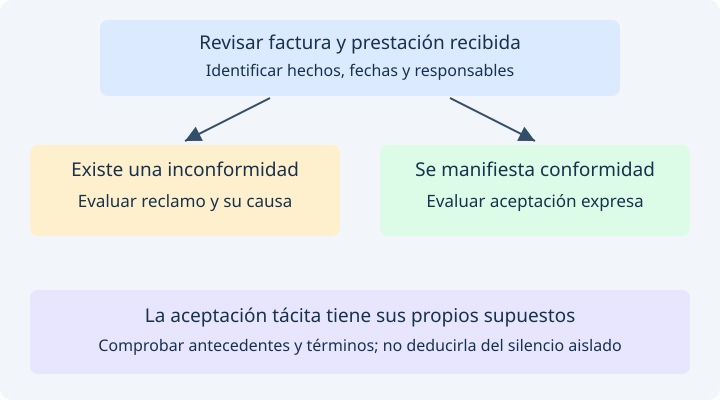

# Procesos y casos prácticos

Los siguientes recorridos explican decisiones de negocio. No todas las facturas
recorren las mismas etapas ni todos los eventos son compatibles entre sí.
Cada acto requiere sus antecedentes y un actor facultado.

## Recepción y aceptación

Comercial Andina vende mercancía a Distribuciones del Norte. El comprador recibe
primero la factura y posteriormente los productos. Puede dejar constancia de la
recepción de la factura mediante [030](events/030.md) y de los productos mediante
[032](events/032.md). Si existe una inconformidad, debe evaluar el
[reclamo 031](events/031.md), su causa y sus términos.

La [aceptación expresa 033](events/033.md) corresponde a una manifestación del
adquirente. La [aceptación tácita 034](events/034.md) exige comprobar sus supuestos
y la declaración correspondiente del facturador. No se deben registrar ambas
aceptaciones como pasos obligatorios ni dar por aceptada una factura solo porque
haya sido validada por DIAN.

## Inscripción, negociación y endoso

Después de comprobar recepción, aceptación y requisitos del título valor,
Comercial Andina evalúa la [inscripción 036](events/036.md). Si existe negociación
directa previa, identifica al comprador y el estado real de pago.

El negocio con Financiera Central determina el endoso: [propiedad 037](events/037.md),
[garantía 038](events/038.md) o [procuración 039](events/039.md). No son opciones
intercambiables. Si corresponde un endoso posterior al vencimiento, se revisan
los [efectos de cesión ordinaria 047](events/047.md). Antes de cada acto se
comprueban la tenencia, las facultades y las restricciones existentes.

## Mandato y terminación

Comercial Andina encarga a Gestor del Centro actuar sobre dos facturas. El
[mandato 043](events/043.md) debe establecer aceptación, facultades, duración,
documentos y soportes. Gestor del Centro revisa vigencia y alcance antes de cada
actuación, en lugar de asumir que un encargo permite realizar todos los eventos.

Si se presenta una causa de [terminación 044](events/044.md), se identifica el
mandato concreto y se conservan las declaraciones y fecha correspondientes.
La terminación no borra los actos ya realizados ni resuelve por sí sola sus efectos.

## Aval y limitación de circulación

Una entidad puede otorgar un [aval 035](events/035.md) sobre la obligación de una
factura. Ese compromiso debe distinguirse de un endoso en garantía.

Si una autoridad dispone una [limitación 041](events/041.md), deben identificarse
el acto, su alcance y su soporte antes de evaluar nuevas actuaciones. Una
[terminación 042](events/042.md) afecta a la limitación referenciada; no demuestra
que no existan otras restricciones sobre el título.

## Informe, pago y protesto

El tenedor comunica los datos necesarios mediante el [informe 046](events/046.md)
en las condiciones aplicables. Esa comunicación no reduce el saldo. Un abono
real de 25.000 pesos sobre un valor actual de 100.000 se documenta como
[pago parcial 045](events/045.md), con saldo de 75.000.

Si existe una causa de [protesto 048](events/048.md), se revisan modalidad, hechos,
fechas y acta. El protesto no reemplaza el reclamo ni constituye un pago.

## Transferencia de derechos económicos

Comercial Andina acuerda con Financiera Central una
[transferencia 049](events/049.md). Se precisan derechos, valor, responsabilidad
y participantes. La [notificación 050](events/050.md) informa al deudor sobre esa
transferencia. El [pago 051](events/051.md) documenta el pago correspondiente y su
saldo. Son tres actos distintos; el registro de uno no demuestra que los otros
hayan ocurrido.

## Comprobaciones comunes

Antes de continuar un proceso deben identificarse la factura, los eventos
antecedentes, las partes y su calidad, las facultades, las fechas, los soportes,
los valores y los resultados de validación. El orden de una lista de consulta
no reemplaza la revisión de esas relaciones.

Las fuentes específicas se encuentran en las páginas de cada evento y en
[Fuentes y alcance](sources.md).
