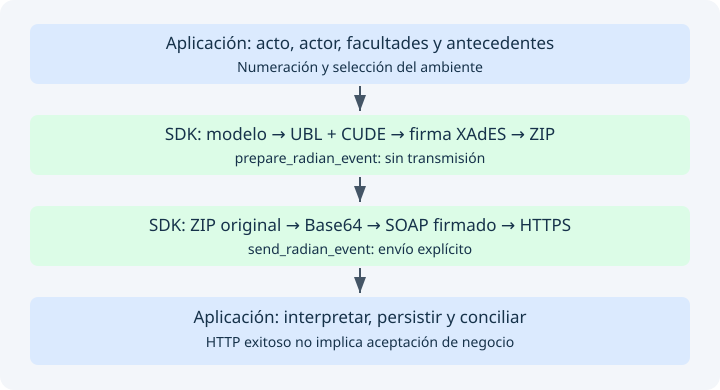

# Comunicación con DIAN y las dos firmas

Este capítulo describe **lo implementado en 0.6.0**, contrastado con el código,
las pruebas, los WSDL guardados y RADIAN 1.1 §§8, 9.3–9.4, 11 y 12.
No constituye una certificación de interoperabilidad con participantes reales.
La [matriz de evidencia](evidence.md) distingue pruebas locales de verificaciones pendientes.



## Transporte y contrato SOAP

Las ocho consultas y `SendEventUpdateStatus` utilizan HTTPS y SOAP 1.2,
con operaciones document/literal del servicio WCF. El sobre separa `Header`,
que contiene WS-Addressing y WS-Security, de `Body`, que contiene la operación y
sus parámetros en el orden del contrato. Un cambio de orden no es inocuo.

| Ambiente | POST HTTP | `wsa:To` firmado | ProfileExecutionID UBL |
| --- | --- | --- | --- |
| Producción | `https://vpfe.dian.gov.co/WcfDianCustomerServices.svc` | Mismo destino + `?WSDL` | `1` |
| Habilitación | `https://vpfe-hab.dian.gov.co/WcfDianCustomerServices.svc` | Mismo destino + `?WSDL` | `2` |

`wsa:Action` usa la acción WCF correspondiente a la operación. No se descarga ni
interpreta WSDL durante la ejecución. `?WSDL` en `To` es parte del valor firmado,
no una instrucción para enviar la petición a ese recurso.

Por defecto el cliente HTTP se crea y cierra por operación. Desde 0.6.0 puede
optar por conexiones reutilizables con cierre explícito, según la
[guía de rendimiento](performance.md). Un timeout positivo y finito se
aplica a conexión, lectura, escritura y pool; no impone una fecha límite total.
No hay reintentos, redirecciones ni cambio de ambiente automático. El directorio
de correos añade un GET de descarga, con su propio cierre de recursos.

## Firma de autenticación: WS-Security X.509

Cada petición construye un sobre nuevo con estos pasos:

1. Utilice certificado y clave privada ya cargados en memoria desde el PFX/P12.
2. Genera identificadores nuevos para el token y `To`; no reutiliza el sobre anterior.
3. Añade `Timestamp` con `Created` UTC y `Expires` cinco minutos después.
4. Inserta el certificado público DER en Base64 como `BinarySecurityToken`.
5. Incluye `Action`, `To` y el cuerpo de la operación.
6. Firma la referencia al elemento **`wsa:To`** mediante RSA-SHA256.
7. Serializa el sobre y lo transmite por HTTPS.

| Propiedad | Perfil SOAP implementado |
| --- | --- |
| SignatureMethod | `http://www.w3.org/2001/04/xmldsig-more#rsa-sha256` |
| DigestMethod | `http://www.w3.org/2001/04/xmlenc#sha256` |
| CanonicalizationMethod | Exclusive C14N, `http://www.w3.org/2001/10/xml-exc-c14n#` |
| Prefijos inclusivos de SignedInfo | `wsa soap wcf` |
| Transform de la referencia a To | Exclusive C14N, prefijos `soap wcf` |
| KeyInfo | SecurityTokenReference al BinarySecurityToken |
| Recurso firmado | URI `#<Id de To>` |

**El SDK no firma `Body` ni `Timestamp` con esta firma.** La presencia del
Timestamp en Security no significa que sea una referencia de SignedInfo.
El certificado público permite verificar la firma; la clave privada y la
contraseña del PFX nunca se insertan en el mensaje.

No confundas esta autenticación de mensaje con un certificado cliente de TLS.
HTTPX utiliza HTTPS, pero la configuración actual no pasa `cert=`. El WSDL
conservado declara `RequireClientCertificate="false"`; el anexo §8.4 habla de
autenticación mutua. También existe una diferencia de namespace: el SignedParts
To del WSDL conservado usa addressing 2004/08, mientras que el SDK utiliza
WS-Addressing 2005/08. Se documentan estas diferencias: las pruebas locales no
resuelven por sí solas qué exige un despliegue DIAN concreto.

## Firma del evento: XMLDSig y XAdES-EPES

La preparación de un evento es independiente de la firma anterior:

1. Valida el modelo de negocio y sus componentes.
2. Construye ApplicationResponse UBL y extensiones DIAN.
3. Calcula CUDE, código de seguridad del software y referencia QR.
4. Inserta una firma XAdES-EPES enveloped en UBLExtensions.
5. Serializa una vez y comprueba el límite de **500.000 bytes de XML firmado**.
6. Comprime esos bytes en un ZIP con exactamente un `ar_<CUDE>.xml`.
7. Devuelve `PreparedRadianEvent` sin transmitir.
8. Al enviar, codifica el ZIP original en Base64 y crea otro sobre SOAP firmado.

| Propiedad | Perfil de evento implementado |
| --- | --- |
| SignatureMethod | RSA-SHA256 |
| DigestMethod de referencias | SHA-256 |
| CanonicalizationMethod | Inclusive C14N, `http://www.w3.org/TR/2001/REC-xml-c14n-20010315` |
| Referencia al documento | URI vacía `""`; transforms enveloped-signature + inclusive C14N |
| Referencia a KeyInfo | URI `#<Id de KeyInfo>` |
| Referencia a SignedProperties | URI `#<Id de SignedProperties>`, Type `http://uri.etsi.org/01903#SignedProperties` |

La canonicalización SOAP es **exclusiva** y la del evento es **inclusiva**.
Copiar parámetros entre los dos perfiles puede invalidar la firma.
`SignedProperties` incluye `SigningTime`, `SigningCertificate`, política de firma
y rol del firmante. `KeyInfo` incorpora certificado, clave pública RSA y los
certificados adicionales suministrados por el PKCS#12. El SDK no construye una
cadena confiable ni consulta una autoridad de certificación automáticamente.
El rol `supplier` o `thirdparty` procede de `RadianSoftware`; no sustituye la
validación de facultades de los participantes.

La política incorporada por el SDK se identifica mediante:

```text
URL: https://facturaelectronica.dian.gov.co/politicadefirma/v2/politicadefirmav2.pdf
Digest SHA-256 en Base64: dMoMvtcG5aIzgYo0tIsSQeVJBDnUnfSOfBpxXrmor0Y=
```

El digest es una constante del perfil implementado, no un cálculo que descargue
el PDF en cada firma. Consulte [evidencia](evidence.md) antes de interpretarlo
como comprobación de los bytes que hoy entrega ese servidor.
El mismo certificado del cliente firma el evento y el sobre; la API no permite
seleccionar certificados separados para esas dos tareas.

### Qué significa cada hash

| Valor | Entrada y algoritmo | No confundir con |
| --- | --- | --- |
| CUDE general | SHA-384 de la concatenación prescrita en RADIAN §12 | Firma RSA o hash del XML completo |
| CUDE de mandato | Perfil 043, receptor DIAN por defecto y campos de mandato | Numeración de factura |
| CUDE de endoso en blanco | Omite identidad del endosante e incorpora clase `2` | CUDE general sin cambios |
| SoftwareSecurityCode | SHA-384 de software ID + PIN + número de evento | Contraseña del PKCS#12 |
| DigestValue XMLDSig | SHA-256 del recurso transformado | CUDE |
| SignatureValue | Firma RSA-SHA256 de SignedInfo canonicalizado | Cifrado del documento |

Para el CUDE general se concatenan, sin separadores: número del evento, fecha ISO,
hora ISO colombiana con segundos, NIT generador, NIT receptor, código de evento,
número del documento referenciado, código de tipo documental y PIN del software.
El perfil de mandato y el endoso en blanco tienen reglas específicas: no derives
sus hashes mediante una fórmula general recortada a mano.
La fecha y hora se normalizan conjuntamente a UTC−05:00; una conversión puede
cambiar el día. Los eventos 030–034 exigen fecha de emisión igual a la de firma en
Colombia. No se aplica esa misma restricción local a todas las demás familias.

### Leer un fragmento de firma

Este esquema omite valores e identificadores: **no es XML firmado verificable**.

```xml
<ds:SignedInfo xmlns:ds="http://www.w3.org/2000/09/xmldsig#">
  <!-- CanonicalizationMethod y SignatureMethod según el perfil UBL -->
  <ds:Reference URI=""><!-- documento, excluyendo la firma --></ds:Reference>
  <ds:Reference URI="#key-info-demo"><!-- material público --></ds:Reference>
  <ds:Reference URI="#properties-demo"
    Type="http://uri.etsi.org/01903#SignedProperties">
    <!-- propiedades XAdES, incluida política -->
  </ds:Reference>
</ds:SignedInfo>
```

## Conservar y comprobar

Los PDF embebidos aumentan el XML por Base64 y cuentan dentro del límite de
500.000 bytes. No se solventa un exceso truncando un soporte. No reformatees,
indentés, reconstruyas ni vuelvas a serializar XML firmado para enviarlo.
Guarde los bytes exactos de `PreparedRadianEvent`, protegidos junto con ambiente,
CUDE y número. Reenviar el mismo artefacto tampoco garantiza idempotencia.

Las pruebas verifican las firmas después de serializar y comprueban el ZIP.
Son evidencia matemática con certificados sintéticos; no comprueban confianza,
vigencia, revocación, autorización ni aceptación DIAN. Los parsers de respuestas
no verifican sus firmas ni ejecutan XSD/Schematron integral. Esas comprobaciones
requieren una política adicional de la aplicación y/o validación por DIAN.
